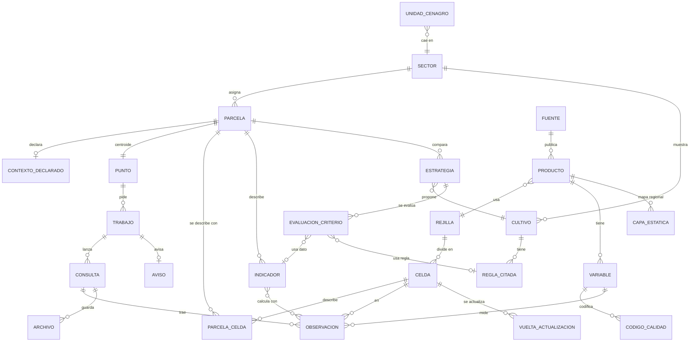

# T03 · 1. Modelo lógico de los datos del esquema mixto

> **Área:** datos (Damaris). **Tarea:** [README.md](README.md), §3.1. **Estado:** borrador para revisar con Erick, 15/11/2026.
> Escrito con asistencia de IA (Claude Code); declarado en [entrega/uso-de-ia.md](../../entrega/uso-de-ia.md).
>
> **Qué es:** las entidades que hay en los datos de TARPU, cómo se relacionan y cómo se guarda una serie. Es diseño, no código: no cambia `backend/` ni crea ninguna base de datos. Lo que propone para el código está en el §8, para Erick.
>
> **Cómo se comprobó:** hay dos niveles de evidencia, y cada fila dice cuál tiene.
> - **Verificado con datos:** abierto en un archivo real de `trabajo/T01-paquete-extraccion/salida/`, `trabajo/T01-paquete-extraccion/cache/` o `trabajo/extraccion_pesada/salida/`.
> - **Según el código; no verificado con datos:** deducido de `backend/tarpu_datos/` o `backend/tarpu_api/`. Son las rutas de `backend/almacen/`, que no está en esta computadora (V-03).

## 1. La pregunta central: ¿la serie se guarda por parcela o por celda?

**Propuesta: por celda o píxel de la fuente.** La parcela se une a sus celdas con una relación que dice *cómo* la toca cada una.

### 1.1 Por qué

| Hecho comprobado | Qué implica |
|---|---|
| Hoy el trabajo de capa 2 tiene como clave **el punto con 4 decimales** (`clave_punto` en `trabajos.py`), y la caché de T01 también va por punto (`cache/ornl/m15p6400_m71p6000/`). | Dos parcelas vecinas generan dos trabajos aunque caigan en el mismo píxel y bajen los mismos valores. |
| POWER usa **dos rejillas**: la meteorología va en celdas de 0,5° × 0,625° y la radiación en celdas de 1° × 1° (`leer.py`, `power_celda`). En Majes, el punto urbano y el de riego tienen **la misma radiación los 365 días de 2025** y **distinta temperatura** (01/01/2025: 20,08 °C frente a 16,50 °C; [en-curso.md](../../docs/informes/en-curso.md)). | «Celda de POWER» no es una sola cosa: cada grupo de variables tiene su rejilla. Guardar por punto oculta que dos puntos comparten un dato y que otro no. |
| ORNL devuelve con cada bloque la esquina del píxel en la proyección sinusoidal de MODIS y su tamaño: `xllcorner`, `yllcorner` y `cellsize` (`mod13q1_chivay_…original.json`: −7666898,86; −1739275,98; 231,656 m; tesela `h11v10`). | El píxel de MODIS se puede identificar sin adivinar: (producto, `xllcorner`, `yllcorner`). |
| Los píxeles de MODIS no miden lo mismo: 231,66 m (MOD13Q1), 463,31 m (MOD16A2GF y MCD12Q1) y 926,63 m (MOD11A2), según el `cellsize_m` de cada procedencia de Chivay. | Una misma parcela cae en un píxel distinto para cada producto. La celda va **por producto**, no por fuente. |
| `leer_parcela` ya usa reglas distintas según la fuente: NASADEM, píxeles de 30 m **cuyo centro cae dentro**; SoilGrids, píxeles de 250 m **que tocan** la parcela; GAEZ y POWER, **la celda que contiene el centroide**. | Esa regla es justo el atributo que le falta a la relación parcela ↔ celda. |
| Límite científico (AGENTS.md §6): un dato regional no se vuelve de parcela por dibujar un polígono. | Si el dato queda guardado en su celda, la pantalla siempre puede decir de qué escala es («tu zona: celda de ≈ 55 × 67 km»), y el mapa sabe que no debe colorear el interior de la parcela con él (docs/10 §5.3). |

### 1.2 Qué se gana y qué cuesta

- **Se gana:** no se baja dos veces el mismo píxel; la escala real del dato queda guardada; la actualización periódica (`actualizacion.py`) recorre celdas, no parcelas, y cada celda se actualiza una sola vez.
- **Cuesta:** hay que calcular el identificador de la celda de cada fuente antes de pedirla. Para POWER y los rasters es aritmética de la rejilla; para MODIS solo se sabe **después** de la primera respuesta de ORNL (§9, tarea V-02).
- **En la demo no cambia nada obligatorio:** los archivos por punto siguen sirviendo. Basta con registrar a qué celda pertenece cada punto (§8, propuesta P-01).

## 2. Entidades

Parte de la lista del README (§3.1) corregida. Las marcadas **nueva** no estaban.

| # | Entidad | Qué es | Atributos clave | Dónde está hoy | Evidencia |
|---|---|---|---|---|---|
| E01 | **Parcela** | El contorno que dibuja el usuario | id, contorno (GeoJSON, `[lon, lat]`), área, perímetro, centroide, sector asignado y regla usada (altitud media de NASADEM), fecha de creación | `almacen/parcelas/{id}/parcela.json` | Según el código; no verificado con datos |
| E02 | **Contexto declarado** | Lo que dice el agricultor | cultivo actual, cultivo anterior, agua (`secano`, `riego`), meses en campo, prioridades (orden de lectura, **no pesos**); `null` = «no sé»; origen fijo «declarado» | `contexto.json`; esquema `contrato/esquemas/ContextoEntrada.json` | Esquema JSON leído; datos según el código, no verificado con datos |
| E03 | **Punto** (nueva) | Coordenada para la que se pide la capa 2: centroide de una parcela o lugar de ejemplo | clave (4 decimales), lat, lon, nombre (`majes_riego`, `chivay`, `valle_s2`), registrado para actualizar | `almacen/puntos.json` | Según el código; no verificado con datos |
| E04 | **Fuente** | El proveedor y su servicio | id, proveedor, servicio (ej. ORNL frente a AppEEARS para MODIS), licencia o cita, URL base | Repartido en cada `procedencia.json` y en `catalogo/base_arequipa.json` | Verificado con datos (T01) |
| E05 | **Producto** | Un conjunto de datos de una fuente | id (`MOD13Q1`, `SPL3SMP_E.006`, `NASADEM_HGT.001`…), versión, rejilla (E07), frecuencia, período disponible, latencia observada | Procedencias y `request.json` de AppEEARS | Verificado con datos (T01) |
| E06 | **Variable** | Una banda o columna de un producto | id, nombre, unidad del proveedor, unidad final, factor y desplazamiento, rango válido, valor de relleno, tipo (`continua` o `categorica`), qué dice y qué no | Ej.: `bands` de ORNL, `soilgrids_unidades.json`. Detalle en `diccionario-variables.md` | Verificado con datos (T01) |
| E07 | **Rejilla** (nueva) | La forma de las celdas de un producto | proyección (EPSG:4326 o sinusoidal de MODIS), tamaño de celda, origen | Implícita en el código (`power_celda`, cabeceras GeoTIFF) | Según el código; no verificado con datos |
| E08 | **Celda o píxel** | Una unidad espacial de una rejilla | rejilla, identificador (§3), centro, geometría, atributos propios (ej. elevación de la celda de POWER: 4351,89 m en Chivay) | Nombres de archivo (`power_celda_m15_500_m71_875`…) | Elevación verificada con datos (`power_chivay_…procedencia.json`); nombre del archivo según el código |
| E09 | **Relación parcela ↔ celda** (nueva) | Qué celdas describen una parcela y cómo | parcela, celda, regla (`centro_dentro`, `toca`, `contiene_centroide`), número de píxeles | Se calcula al vuelo en `leer_parcela`; no se guarda | Según el código; no verificado con datos |
| E10 | **Capa estática** | Un mapa regional completo | producto, variable, profundidad, estadístico (media, Q0,05, Q0,95), archivo, CRS, nivel | `base_arequipa/soilgrids/*.tif` (99), `gaez/*.tif` (100), `nasadem/*.zip` (20) | Según el manifiesto y el código; los archivos no se abrieron |
| E11 | **Observación** | Un valor de una variable en una celda y una fecha | variable, celda, fecha, valor o vacío, calidad (E12), motivo del vacío (§4), consulta (E14) | Filas de `*.normalizado.csv` y `*.detalle.csv` | Verificado con datos (T01) |
| E12 | **Código de calidad o clase** (nueva) | Lo que significa un código del proveedor | variable, código, etiqueta, fuente de la etiqueta | Ej.: `pixel_reliability` 1 = «marginal»; `LC_Type1` 10; `retrieval_qual_flag` de SMAP | Verificado con datos (T01) |
| E13 | **Archivo** (nueva) | Un archivo guardado | ruta, nivel (`original`, `normalizado`, `derivado`, `detalle`, `procedencia`), consulta de la que sale | Los tres o cuatro archivos por producto y lugar | Verificado con datos (T01) |
| E14 | **Consulta o procedencia** | Una petición a un proveedor | URL de la petición, fecha de consulta, versión del servicio, peticiones, reintentos, bloques fallidos, método de conversión | `*.procedencia.json`, `request.json` de AppEEARS | Verificado con datos (T01) |
| E15 | **Trabajo** | La extracción de capa 2 de un punto | clave del punto, estado general, estado por fuente y producto, vacíos del proveedor, fallos de descarga, fechas, aviso, cancelación, parcela | `almacen/trabajos/<clave>.json` | Según el código; no verificado con datos |
| E16 | **Aviso** (nueva, separada del trabajo) | El aviso de que el trabajo terminó | estado (`pendiente`, `por_enviar`), canal (sin decidir), desde cuándo | Dentro del trabajo | Según el código; no verificado con datos |
| E17 | **Vuelta de actualización** (nueva) | Una actualización periódica | tarea (POWER, MODIS, cobertura), punto o celda, última fecha, resultado | `almacen/actualizacion.json` | Según el código; no verificado con datos |
| E18 | **Sector y cultivo del sector** (nueva) | S1, S2, S3 (DT-18) y los cultivos que se muestran en cada uno (DT-20) | sector, pisos del INEI, límites de altitud con su cita, cultivos | `catalogo/sectores.json` | Archivo leído |
| E19 | **Unidad agropecuaria (CENAGRO 2012)** (nueva) | Un registro del censo | código, coordenadas, altitud, piso; cultivos por sector | `base_arequipa/cenagro2012/`, `investigacion/cenagro2012_*.json` | `investigacion/` existe; `base_arequipa/cenagro2012/` según el código, no verificado con datos |
| E20 | **Cultivo y regla citada** (nueva) | Un cultivo del catálogo y sus rangos | cultivo, familia, rangos óptimo y absoluto, cita (FAO EcoCrop), fecha del catálogo | `catalogo/ecocrop_2026-11-14.json`, `investigacion/` | Archivo leído |
| E21 | **Indicador derivado** | Una descripción calculada para la pantalla 5 | id, método citado, variables usadas, celdas usadas, período, valor por mes o fecha, faltantes listados | `indicadores.json` (hoy solo POWER) | Según el código; no verificado con datos |
| E22 | **Estrategia** (nueva) | Una alternativa de rotación | id (`E1`…), cultivo, tipo (`repetir_actual`, `cambiar_de_familia`, `cultivo_del_catalogo`), por qué aparece, no incluidos, vacíos | `rotaciones.json` (`motor/estrategias.py`) | Según el código; no verificado con datos |
| E23 | **Evaluación por criterio** | Un criterio de un cultivo para una parcela | estrategia, criterio, estado (`dentro_optimo`, `dentro_absoluto`, `fuera_absoluto`, `sin_dato`, `sin_regla`), dato usado (indicador), regla (E20), nota | `motor/comparacion.py` | Según el código; no verificado con datos |

## 3. Cómo se identifica una celda en cada fuente

| Producto | Rejilla | Identificador propuesto | Se conoce… |
|---|---|---|---|
| POWER, meteorología | 0,5° × 0,625°, EPSG:4326 | centro redondeado a la rejilla, como en `power_celda` | antes de pedir |
| POWER, radiación | 1° × 1° | ídem con la rejilla de 1° | antes de pedir (por verificar el origen de la rejilla, V-01) |
| MOD13Q1, MOD16A2GF, MOD11A2, MCD12Q1 | Sinusoidal de MODIS, 231,66 / 463,31 / 926,63 m | (producto, `xllcorner`, `yllcorner`) que devuelve ORNL | después de la primera respuesta (V-02) |
| SoilGrids | GeoTIFF EPSG:4326, ≈ 250 m (0,00225°, manifiesto `base_arequipa.json`) | (archivo de referencia, fila, columna), como `_pixeles_raster` | antes de pedir |
| GAEZ v4, servicio `identify` (T01) | 0,0833° | El servicio **no devuelve identificador de celda**: responde `objectId: 0`, `name: "Pixel"` y la coordenada pedida (`cache/gaez/…/identify_256824.json`). El `objectid` (ej. 256952) es **la capa**, no la celda: 256952 = `suHi_wpo`, papa con riego, y aparece igual en los tres lugares (`identify_256952.json`). Clave propuesta: (`objectid` de la capa, fila y columna calculadas en la rejilla de 0,0833°) | la capa, antes; la fila y la columna, cuando se verifique el origen de la rejilla (V-10) |
| GAEZ v4, GeoTIFF de la base | 0,0833° | (archivo de la capa, fila, columna) de la cabecera del GeoTIFF, como `_pixeles_raster` | antes de pedir (según el código; no verificado con datos) |
| NASADEM | 1″ (≈ 30 m) | (tesela, fila, columna) | antes de pedir |
| SMAP L3E (AppEEARS) | 9 km, EASE-Grid (metadatos de `smap_l3_puntos`) | (`Line_Y`, `Sample_X`) del CSV de AppEEARS (Majes riego: 1040, 1154) | después de la respuesta |
| SMAP L4, HLS | Pendientes | Pendiente de verificar con la descarga | — |
| Horas de luz (FAO-56) | Sin rejilla: depende solo de la latitud | la latitud del punto | antes (se calcula) |

## 4. Valores vacíos: un faltante nunca es 0

Cada observación sin valor lleva **un motivo** de esta lista. Los ejemplos están verificados con datos salvo que se diga otra cosa.

### 4.1 Motivos

| Motivo | Qué significa | Ejemplo |
|---|---|---|
| `relleno_del_proveedor` | El proveedor entregó su valor de relleno | MOD11A2 en S2: el crudo vale 0, que es su `fill_value`, en 3 fechas de día y 31 de noche (`missing_values_by_band`; ej. 18/02/2016, crudo 0 en las dos bandas). SMAP L3E: −9999 el 01/01/2025 en Majes riego. POWER: relleno −999 (`fill_value` de la procedencia; 0 días en S2) |
| `fuera_de_rango_valido` | El valor está fuera de `valid_range` | Regla del normalizado de ORNL: «fill or out of valid_range ⇒ empty». Ej. de rango: MOD11A2, 7500 a 65535 |
| `calidad_no_valida` | Hay valor, pero su bandera de calidad lo descarta | Pendiente: qué códigos de `pixel_reliability` (S2: 235 «bueno», 37 «marginal») y de `retrieval_qual_flag` cortan la línea se decide con cita en `agregaciones.md` |
| `sin_verificar` | **No es un vacío:** el proveedor entrega el valor y se guarda el **entero sin convertir**. TARPU no lo convierte porque su factor y su unidad no están verificados. No es un relleno del proveedor ni un fallo de descarga | SoilGrids `uncertainty`: el entero sin convertir se guarda en `.largo.csv` (pH 0–5 cm en S2: 5). El normalizado no trae valor convertido; su columna lleva la etiqueta «(sin verificar)». MODIS con `add_offset` ≠ 0 tendría el mismo trato (regla de `ornl.py`; no ha ocurrido) |
| `fecha_no_publicada` | El servicio no lista esa fecha para el producto. No es un fallo: `dates_in_period` y `dates_returned` coinciden | MOD11A2 tiene 505 fechas y MOD16A2GF 506 en 2015–2025. La que falta es el **16/10/2022**, en los tres lugares. Causa sin explicar (V-09) |
| `nodata_del_raster` | El píxel del mapa no tiene dato | `pixel()` en `leer.py`: «sin dato del proveedor (nodata)» (según el código; no verificado con datos) |
| `fuera_de_cobertura` | El punto cae fuera del mapa o de la caja de Arequipa | `leer()`: «está fuera de la base de Arequipa» (según el código; no verificado con datos) |
| `fallo_de_descarga` | El bloque o la capa no llegó | `fallos_de_descarga` del trabajo; en T01, 0 bloques fallidos (`missing_blocks: []`) |
| `no_disponible` | La vía de extracción no existe todavía | HLS y SMAP en `trabajos.py` (`PENDIENTES`) |

### 4.2 Dónde está hoy el motivo y cómo se traduce

**Los `detalle.csv` no traen el motivo.** Se revisaron los cuatro de MODIS en S2: sus columnas son `fecha`, `modis_date`, las bandas `*_crudo`, `calidad` o `clase_igbp` y `tesela`. El motivo por fecha **se deduce** comparando el crudo con `fill_value` y `valid_range` de la procedencia. El texto que existe hoy es **un resumen por banda o capa**, en la lista `faltan` de cada fuente (igual en `trabajo/T01-paquete-extraccion/tarpu_datos/` y en `backend/tarpu_datos/fuentes/`), que el trabajo usa para separar vacíos y fallos.

| Fuente | Texto actual (resumen) | Motivo |
|---|---|---|
| POWER (`power.py`) | `«{variable}: {n} días con relleno {relleno}»` | `relleno_del_proveedor` |
| MODIS (`ornl.py`) | `«{banda}: {n} fechas sin valor válido»` | `relleno_del_proveedor` o `fuera_de_rango_valido`: el texto junta los dos; se separan con el crudo del `detalle.csv` |
| MODIS (`ornl.py`) | `«{producto}: {fecha} a {fecha} (…), {error}»` | `fallo_de_descarga` |
| MODIS (`ornl.py`) | `«{banda}: add_offset … distinto de 0 sin regla verificada; columna vacía»` | `sin_verificar` |
| SoilGrids (`soilgrids.py`) | `«{capa}: sin predicción en el píxel (nodata)»` | `nodata_del_raster` |
| SoilGrids (`soilgrids.py`) | `«{capa}: factor y unidad de «uncertainty» sin verificar; se guarda el entero»` | `sin_verificar` |
| SoilGrids (`soilgrids.py`) | `«{capa}: sin d_factor (…)»` | `sin_verificar` |
| SoilGrids (`soilgrids.py`) | `«{capa}: GeoTIFF no legible (…)»` o la línea del error | `fallo_de_descarga` |
| GAEZ (`gaez.py`) | `«{capa} (…): valor no numérico del proveedor: …»` | `relleno_del_proveedor` (por verificar qué devuelve GAEZ en ese caso; no ha ocurrido) |
| GAEZ (`gaez.py`) | `«{capa} (…): {error}»` | `fallo_de_descarga` |
| Base (`leer.py`) | `«sin dato del proveedor (nodata)»`, `«el punto cae fuera del mapa»`, `«…fuera de la base de Arequipa…»` | `nodata_del_raster`, `fuera_de_cobertura` |
| Trabajo (`trabajos.py`) | `estado: no_disponible` + `motivo` de `PENDIENTES` | `no_disponible` |
| ORNL, fecha que el servicio no lista | Ningún texto: solo se ve al comparar productos | `fecha_no_publicada` |

**Caso abierto, GAEZ en Chivay:** las 100 capas de `gaez_chivay.normalizado.csv` valen 0; en Majes riego hay 26 distintas de 0. Que 0 sea un índice de aptitud real o una zona sin evaluar se comprueba en la documentación de GAEZ v4 antes de mostrarlo (V-04; la §9.5 bis del README de T01 trata este límite).

**Estados de un trabajo** (ya en el código, no se cambian): `pendiente`, `en_proceso`, `listo`, `listo_con_vacios`, `parcial`, `sin_datos`, `error`, `cancelado`, y por fuente también `no_disponible`. Se mantiene la distinción entre **vacío del proveedor** (dato completo que no existe en la fuente) y **fallo de descarga**.

## 5. Procedencia: a qué nivel se guarda

- **Por consulta (E14)**, no por observación: cada fila del CSV apunta a la consulta de la que sale. Es lo que ya hacen los `procedencia.json`.
- **Cada indicador (E21) guarda la lista de consultas y celdas que usó.** Así la pantalla puede decir fuente, período, escala y faltantes (docs/10 §5.2) sin repetir el dato en cada número.
- **Lo declarado (E02) tiene origen «declarado por ti»**, nunca una fuente.

## 6. Relaciones

## 7. Comprobación: cada dato de la tabla 1.3 del README tiene su entidad

| Dato (README §1.3) | Entidades |
|---|---|
| Mapas de suelo (SoilGrids, 99 GeoTIFF) | E10 capa estática; E06 variable con `d_factor`; E08 píxel al consultar |
| Mapas de aptitud (GAEZ, 100 GeoTIFF + `_capas.json`) | E10; E06 (cultivo × manejo); E08 |
| Clima por celda (POWER, 63 celdas) | E08 celda (con su elevación); E11 observación diaria; E13 y E14 |
| Relieve (NASADEM, 20 teselas) | E10; E09 con la regla `centro_dentro`; E21 para la pendiente (Horn) y su clase FAO |
| Censo 2012 | E19; E18 |
| Mapa de sectores | E18; E10 como capa derivada (`sectores_0p01`) |
| Manifiesto de la base | E14 por fuente regional; E04 |
| Datos de una parcela (capa 2) | E11 con su E12; E13 (incluye `.detalle.csv`); E14 |
| Trabajo de una parcela | E15; E16 |
| Puntos y actualización | E03; E17 |
| AppEEARS: NASADEM por zona y SMAP L3E por punto (`trabajo/extraccion_pesada/salida/`) | E10 o E11 según sea zona o punto; E14 desde `request.json`; E12 para las banderas de SMAP |
| HLS y SMAP L4 (en cola en AppEEARS) | Pendientes de verificar con la descarga (V-05) |

## 8. Propuestas para el código (para Erick; nada de esto está hecho)

| Id | Propuesta | Por qué |
|---|---|---|
| P-01 | Guardar en el trabajo, por producto, el identificador de la celda o píxel (§3) | Saber cuándo dos puntos comparten dato, sin cambiar los archivos de la demo |
| P-02 | Antes de lanzar ORNL, buscar si otro punto ya tiene ese píxel y reutilizarlo | Solo es posible después de P-01 y de V-02 |
| P-03 | Guardar la relación parcela ↔ celda (E09) junto a `parcela.json` | Hoy se recalcula en cada llamada y la regla de cobertura no queda escrita con el resultado |
| P-04 | Añadir una columna `motivo` por fecha en los `detalle.csv`, con los nombres del §4.1, y conservar los textos actuales como resumen | Hoy el motivo solo existe como resumen por banda (§4.2), y «sin valor válido» junta relleno y fuera de rango |

## 9. Tareas de verificación

| Id | Qué falta saber | Cómo se resuelve |
|---|---|---|
| V-01 | El origen exacto de la rejilla de 1° de la radiación de POWER | Documentación de POWER, o comparar el `cell_elevation_m` de puntos vecinos |
| V-02 | Que `xllcorner` y `yllcorner` de ORNL identifican el píxel de forma estable entre peticiones | Pedir dos puntos dentro del mismo píxel y comparar |
| V-03 | La forma real de `/api/base/parcela` y `/api/trabajos/{clave}` con la base cargada | Pedir a Erick una salida, o la base (`backend/almacen/`, ≈ 620 MB) |
| V-04 | Si el 0 de GAEZ en Chivay es aptitud nula o zona no evaluada | Documentación de GAEZ v4 |
| V-05 | Rejilla, variables, relleno y banderas de HLS (L30, S30) y SMAP L4 | Revisar la descarga cuando `pesados.py esperar` termine |
| V-06 | El factor de `uncertainty` de SoilGrids | Documentación de ISRIC (T01 §9.4) |
| V-07 | Punto de Cabanaconde (S2) | **Coordenada mantenida por decisión de Erick, 15/11/2026** (sin registrar aún en docs/06); el punto cae en ladera: NASADEM 2663 m frente a 2908 m del censo (2663 m: `trabajo/extraccion_pesada/salida/relieve_3_zonas/NASADEM_NC.001_NASADEM_HGT_doy2000042000000_aid0002.tif`, píxel fila 162, columna 162, punto −15.612386, −71.984857; coincide con [backend/PLAN-PLATAFORMAS-Y-COORDENADA.md](../../backend/PLAN-PLATAFORMAS-Y-COORDENADA.md); 2908 m: CENAGRO 2012, [extraccion_pesada/README.md](../extraccion_pesada/README.md)). La pantalla debe decir que el dato describe ese punto, no una chacra |
| V-08 | ~~POWER y horas de luz 2015–2025 de `majes_riego` en T01~~ | **Cerrada:** subidos en el commit `23cc1a3` |
| V-09 | Por qué ORNL no lista el 16/10/2022 en MOD11A2 (sí en MOD16A2GF), en los tres lugares | Consultar `/dates` de MOD11A2 y la documentación del producto |
| V-10 | Origen exacto de la rejilla de 0,0833° de GAEZ, para calcular fila y columna sin el GeoTIFF | Cabecera de un GeoTIFF de la base, o documentación del servicio `res05` |
